# Banto Cost 取扱説明書

Banto Cost は、制御設計・ソフトウェア開発・盤製作・現地調整などを**案件単位**で請け負う会社向けの、案件原価・利益管理アプリです。案件ごとに売上・工数・材料費・外注費・旅費を集め、**予算**と**完了見込の利益**を管理します。受注前の案件見込（確度・時期）と月次の売上見通しも扱います。

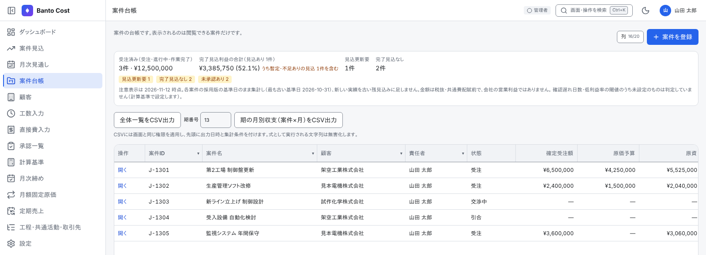

> この説明書の画面に写っている会社名・人名・金額はすべて架空のサンプルです。

## 目次

1. [できること](#できること)
2. [使い始める](#使い始める)
3. [画面の基本操作](#画面の基本操作)
4. [仕事の流れ](#仕事の流れ)
5. [各画面の使い方](#各画面の使い方)
   - [ダッシュボード](#ダッシュボード) / [顧客](#顧客) / [案件台帳](#案件台帳) / [案件の詳細](#案件の詳細)
   - [案件見込](#案件見込) / [月次見通し](#月次見通し)
   - [工数入力](#工数入力) / [直接費入力](#直接費入力) / [承認一覧](#承認一覧)
   - [計算基準](#計算基準) / [月額固定原価](#月額固定原価) / [定期売上](#定期売上) / [月次締め](#月次締め) / [工程・共通活動・取引先](#工程共通活動取引先)
6. [計算のきまり](#計算のきまり)
7. [権限（能力）](#権限能力)
8. [困ったとき](#困ったとき)
9. [開発者向け](#開発者向け)

## できること

| 場面             | できること                                                                             |
| ---------------- | -------------------------------------------------------------------------------------- |
| 受注前           | 案件見込（見込額・確度・受注予定月・売上予定月）を版で残し、確度加重の見通しを出す     |
| 受注             | 受注転換・受注変更（追加・減額）・売上予定の組み替え・売上計上と予定の消し込み         |
| 予算             | 工程×費目の予算版（当初・変更）を作って承認し、実績と比べる                            |
| 実績             | 工数（申請・承認・労務原価）、材料・外注・旅費などの直接費、発注と仮計上の確定         |
| 見込             | 基準日の実績＋残原価で完了見込を作り、予算超過や見込の更新漏れを注意表示する           |
| 月次             | 月次売上見通し、月次締め（締めた月は書き換え不可）、月額固定原価・定期売上の月ごと計上 |
| 集計・出力       | 全体一覧、案件の月別収支（年度またぎ・累計）、CSV 出力                                 |
| 計算基準         | 時間原価単価・目標粗利率などを版で管理し、案件ごとに上書きする                         |
| 案件を閉じるとき | 精算完了の検査（未承認・仮計上・残額）と、精算完了の取消                               |

## 使い始める

### インストール（Windows）

1. [Releases](https://github.com/tyaro/banto-cost/releases) から最新版の `Banto.Cost_<版>_x64-setup.exe` をダウンロードします。
2. ダウンロードしたファイルを実行してインストールします。
   - 現在のプレリリースはコード署名をしていないため、Windows の SmartScreen が「PC を保護しました」と表示することがあります。その場合は「詳細情報」→「実行」で進めます。
3. スタートメニューから **Banto Cost** を起動します。

### 初回の設定

初めて起動すると、最初の管理者アカウントを作る画面が出ます。ユーザー名・表示名・パスワードを決めて登録してください。このアカウントには業務の[能力](#権限能力)がすべて付きます。

ユーザーが1人だけの間は、次回からも起動するとそのままログインした状態で始まります（ログアウトのメニューも出ません）。[ユーザー管理](#能力の付け方)で2人目を追加すると、次の起動から下のログイン画面が出るので、最初に決めたユーザー名とパスワードは控えておいてください。LAN のほかの PC からブラウザで開く場合は、1人でも常にログインが要ります。

「ログイン状態を保持する」にチェックを入れると、30日間はパスワードの入力を省けます。

### 使う前に準備すること

業務を始める前に、次の順で基本の設定をします。

1. **権限（能力）を確かめる** — 金額の閲覧や締めなどは、ロール（管理者・編集者・閲覧者）とは別の「能力」で許可します。初回の設定で作った管理者にはすべて付いています。ほかの利用者を追加したときは「ユーザー管理」で能力を付けます。手順は [権限（能力）](#権限能力) を見てください。
2. **[計算基準](#計算基準)** — 社員の時間原価単価・予算用単価・見込み用単価・目標粗利率などを登録します。未登録の単価は「未設定」となり、0円としては計算しません。
3. **[工程・共通活動・取引先](#工程共通活動取引先)** — 工程（設計・ソフト開発・製作・試験・現地調整・管理・打合せ）と共通活動（社内会議・教育・営業・待機）は初めから入っています。必要に応じて追加し、外注先・仕入先を取引先に登録します。
4. **[顧客](#顧客)** — 取引先の顧客を登録します。

## 画面の基本操作

- **サイドバー**：左のメニューから画面を選びます。画面は仕事の順に「営業」「案件」「日々の入力」「月次」「基準・マスタ」の見出しで分かれています。左上のボタンで折りたためます。
- **検索（Ctrl+K）**：画面名や操作名で検索して移動できます。
- **表示の切り替え**：右上の月のアイコンでライト・ダークを切り替えます。そのほかの表示は「設定」の「外観・言語」で変えられます。
- **一覧の操作**：列見出しの ▾ で絞り込み、見出しのクリックで並べ替え、「列」ボタンで表示する列を選べます。
- **保存していない変更**：入力途中で別の画面へ移ろうとすると確認が出ます。
- **取り返しにくい操作の確認**：受注転換・承認・採用・精算完了・月次締め・月額固定や定期売上の計上などは、押すと確認の画面が開き、対象（案件・金額・月・件数）と「取り消し」（あとで取り消せるか、どう直すか）を示します。内容を確かめてから実行します。
- **同時編集**：同じ記録を別の画面で先に保存していた場合、上書きせずに読み直しを求めます。

## 仕事の流れ

- 受注前は「案件見込」で見込額と確度を管理し、[月次見通し](#月次見通し)に確度加重で反映されます。
- 受注したら案件の詳細で「受注転換」をします。以後は確定受注額と売上予定で見通しに入ります。
- 予算と見込は**版**で残ります。承認済みの予算や採用済みの見込は書き換えず、変えるときは新しい版を作ります。
- 実績（工数・直接費）は承認されてから集計に入ります。未承認や仮計上が残っている間は「（暫定）」と表示されます。

## 各画面の使い方

### ダッシュボード

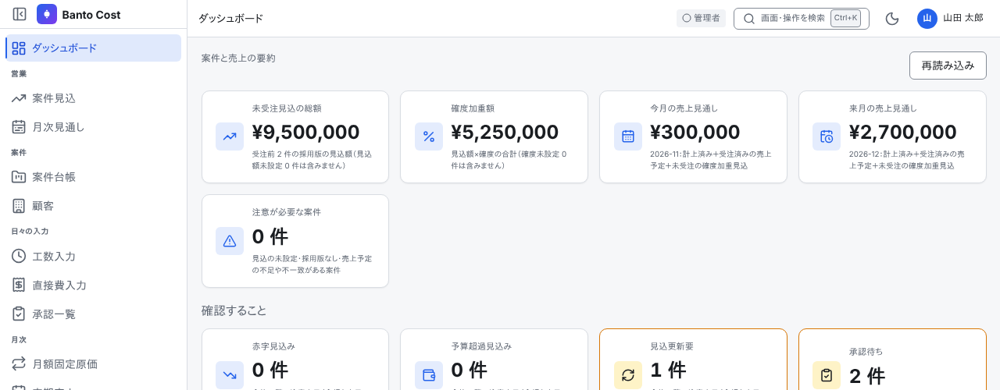

ログイン後に最初に開く画面です。未受注見込の総額、確度加重額、今月・来月の売上見通し、注意が必要な案件の数を表示します。カードから各画面へ移動できます。下のメモ欄は自分用のメモで、パネルを外に出して浮かせることもできます。

### 顧客

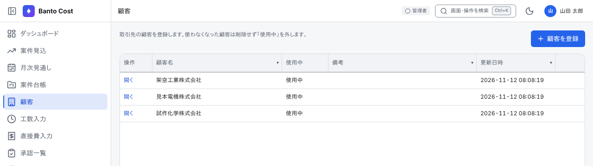

顧客マスタです。「＋ 顧客を登録」で追加し、「開く」で編集します。取引のなくなった顧客は削除せずに「使用中」を外します（過去の案件の記録を残すため）。

### 案件台帳

全案件の一覧です。表示されるのは自分が閲覧できる案件だけです。

- 上の欄に、受注済み案件の件数と確定受注額、完了見込利益の合計、注意表示（見込更新要・完了見込なし・未承認あり）の件数が出ます。
- 一覧には確定受注額・原価予算・原資・完了見込原価・利益率などの列があります。「列」ボタンで表示する列を選べます。
- **直接費の台帳の要確認**（赤い枠）：承認済みの直接費や月額固定の計上に、読めない値（管理計上日・費目など）や食い違い（調整が元の明細を超えるなど）があると出ます。該当する明細は確定・調整でつながる明細ごと集計から外れ、その案件は実績原価が空欄・注意表示「直接費要確認」になり、案件の直接費・予算・完了見込は「集計できない」と表示されます。ほかの案件はそのまま集計されます。要確認がある間は月次締めができません。アプリの操作ではこの状態は起きません（データベースを直接書き換えたときなど）。
- **全体一覧をCSV出力**：画面と同じ内容を CSV で保存します。**期の月別収支をCSV出力**：期（例：「第13期（2026年6月〜2027年5月）」、既定は今の期）を選んで、案件×月の収支を出力します。
- **＋ 案件を登録**：案件ID・案件名・顧客・責任者・状態（引合・見積中・交渉中など）を入力して登録します。

### 案件の詳細

台帳の「開く」で案件の詳細を開きます。1つの画面に、案件の基本情報から精算完了までの欄が縦に並んでいます。基本情報を保存しても詳細にとどまるので、状態を変えたあと続けて予算や精算完了の欄を操作できます。新規登録した案件は、保存するとその案件の詳細が開きます。

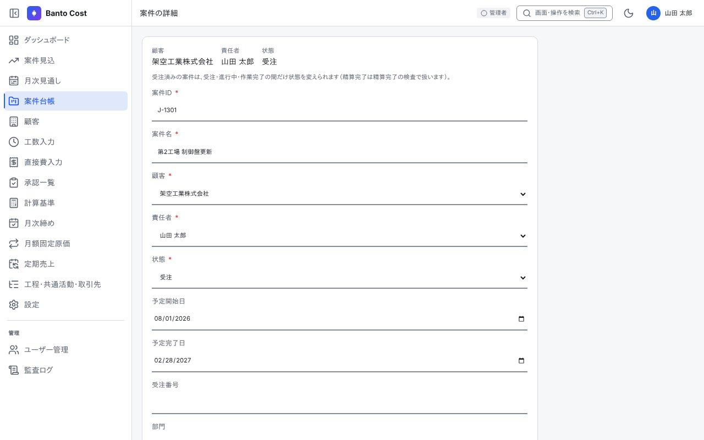

いちばん上の **利益の要約** に、確定受注額・現在の承認予算・最新実績・完了見込原価・完了見込直接利益と利益率・原資と、その日の注意表示（完了見込赤字・予算超過見込み・見込更新要など）が出ます。数字は案件台帳の同じ案件の行と同じです。受注前の案件では注意表示だけが出ます。各欄で保存・承認などを行うと、要約も読み直されます。金額を見る権限がない場合、要約は出ません。

要約の下の **この案件の節** から、各欄の見出しへ移動できます。

上から順に次の欄があります。

| 欄           | 内容                                                     |
| ------------ | -------------------------------------------------------- |
| 基本情報     | 案件ID・案件名・顧客・責任者・状態・予定期間など         |
| 受注・売上   | 受注転換、売上予定、受注変更、売上計上                   |
| 案件見込     | 受注前の見込の版（見込額・確度・受注予定月）             |
| 計算基準     | この案件に適用される単価などと、案件ごとの上書き         |
| 予算         | 予算版の作成・承認と、予算と実績の比較                   |
| 完了見込     | 見込版の作成・採用と、完了見込原価・利益                 |
| 精算完了     | 案件を閉じる前の検査と、精算完了・取消                   |
| 月別収支     | 月ごとの売上・費用・利益と期の小計・累計（CSV 出力あり） |
| 直接費・発注 | 発注と、この案件の直接費の明細                           |
| 工数         | この案件の工数の集計（工程別）                           |

#### 受注・売上

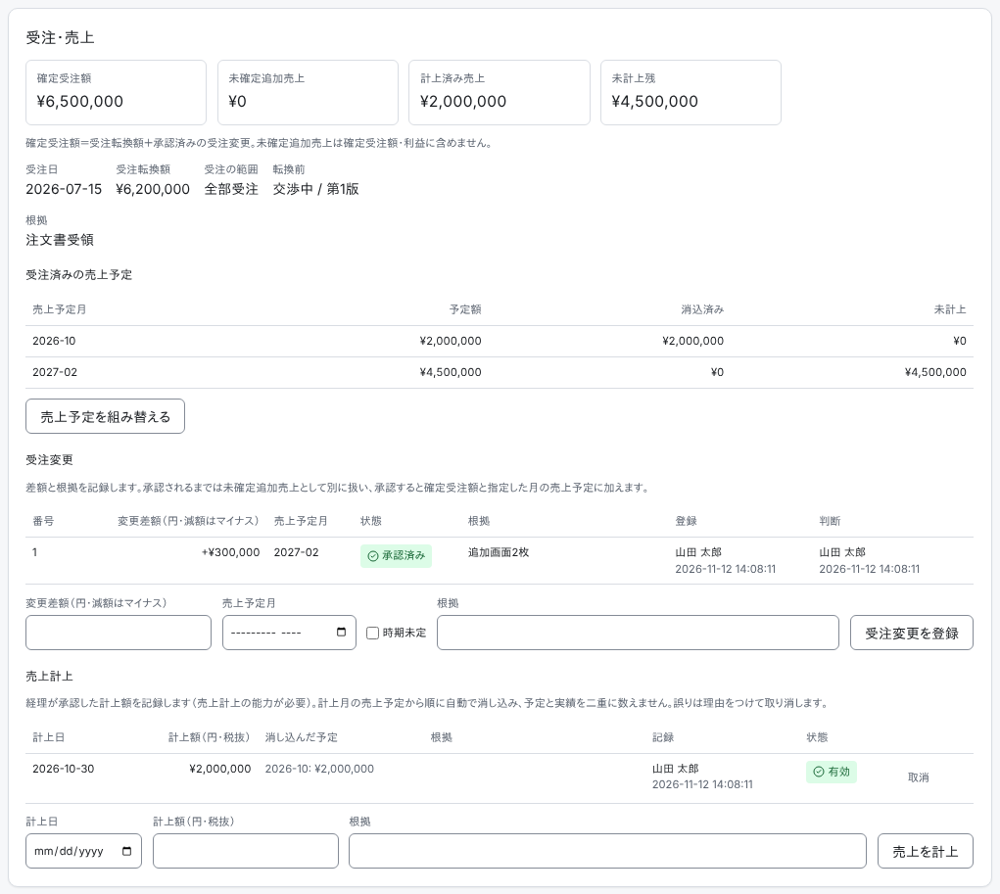

- **受注転換**：受注日・確定受注額・根拠（注文書受領など）・予定期間・月ごとの売上予定を入力します。売上予定の合計は確定受注額と一致させます。
- **受注変更**：追加・減額の差額と根拠、売上予定月を登録します。承認されるまでは「未確定追加売上」として別に扱い、承認すると確定受注額と売上予定に加わります。
- **売上計上**：計上日と計上額（税抜）を入力します。計上月の売上予定から順に自動で消し込むので、予定と実績を二重に数えません。誤りは理由をつけて「取消」します。
- **売上予定を組み替える**：未計上の売上予定の月や金額を変えます。
- **受注転換の取消**：案件の取り違えや、範囲・金額の入力誤りに気づいたときは、「受注転換の取消」を開き、理由を入力して取り消します。案件は転換前の状態に戻り、取り消した転換は履歴に残ります（正しい内容でもう一度受注転換できます）。一部受注を取り消すと、残りの範囲として作られた案件は「中止」になります。取り消せるのは、受注変更・売上計上・予算・工数・直接費・完了見込・月額固定・定期売上をまだ記録していない案件だけです（一部受注は、残りの範囲の案件をまだ受注転換していないときだけ）。取り消せないときは、その理由が一覧で表示されます。

#### 予算

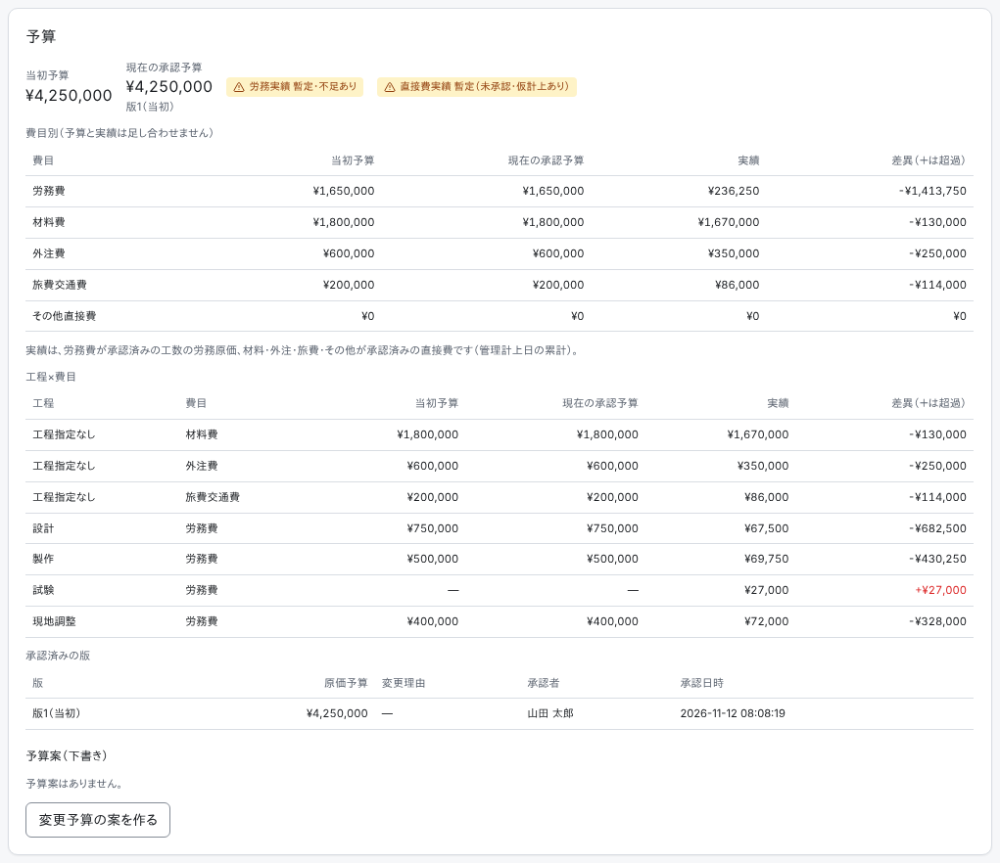

1. 「予算の案を作る」で下書きを作り、工程×費目（労務費は予定工数、それ以外は金額）を入力して保存します。労務費は「予定工数 × 予算用単価」で計算されます。
2. 「承認」で版が確定します。最初の版が**当初予算**、以後の承認済みの版が**現在の承認予算**です。
3. 予算を変えるときは「変更予算の案を作る」で新しい版を作り、変更理由をつけて承認します。前の版は残ります。

表では、当初予算・現在の承認予算・実績・差異（＋は超過）を費目別と工程×費目で比べます。実績に未承認や仮計上が含まれると「暫定」の印が付きます。

#### 完了見込

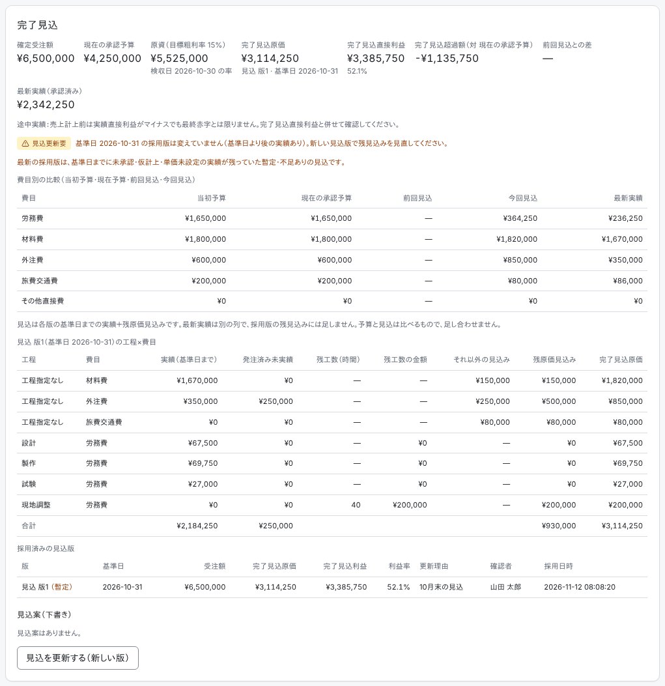

完了見込は「基準日までの実績 ＋ 残りの原価の見込み（残原価見込み）」です。

1. 「見込を更新する（新しい版）」で下書きを作り、基準日・更新理由・工程×費目の残工数や残りの金額を入力します。残工数は見込み用単価で金額になります。発注済みで未実績の額は自動で入ります。
2. 「採用」で版が確定し、完了見込原価・完了見込直接利益・利益率が表示されます。
3. 基準日より後に新しい実績が入ると「見込更新要」と表示されます。新しい版で見直してください。

上の欄には、確定受注額・現在の承認予算・原資（受注額 −目標粗利）・完了見込原価・利益・予算超過額・前回見込との差が並びます。

#### 月別収支

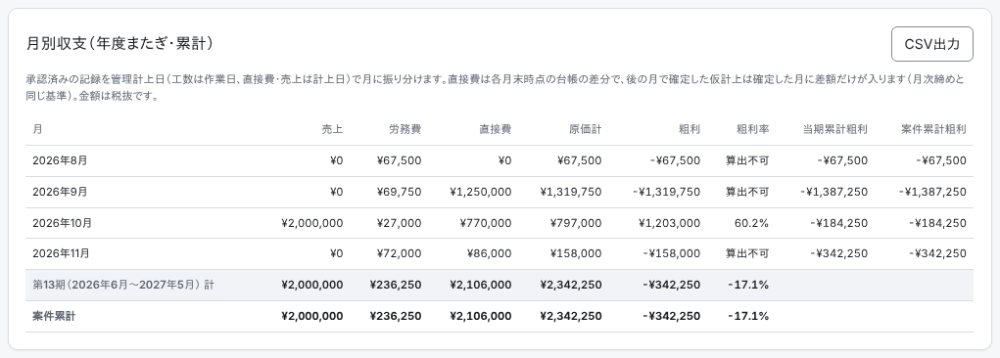

月ごとの売上・労務費・直接費・利益を、期（6月〜翌5月）の小計と案件の累計とあわせて表示します。年度をまたぐ案件も1つの表で見られます。「CSV出力」で保存できます。

#### 直接費・発注

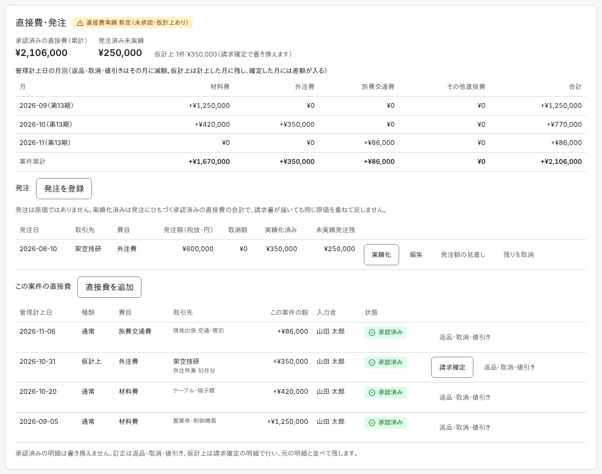

- **発注を登録**：発注日・取引先・費目・発注額を登録します。発注そのものは原価ではありません。実績化した分と発注残（未実績）を表示します。
- **実績化**：発注に対する請求を直接費として登録します。請求が未着のときは「仮計上」で登録し、請求書が届いたら「請求確定」で置き換えます（二重には数えません）。
- **直接費を追加**：材料費・外注費・旅費交通費・その他直接費を、管理計上日と金額（税抜）で登録します。
- 承認済みの明細は書き換えません。訂正は「返品・取消・値引き」で差額の明細を追加します。

#### 精算完了

案件の作業と請求が終わったら精算完了にします。未承認の工数・直接費、仮計上、未計上の売上残があると検査で止まり、何を処理すればよいかが表示されます。残額は理由と承認をつけて解消できます。精算完了の取消（作業完了に戻す）は理由をつけて行います。

### 案件見込

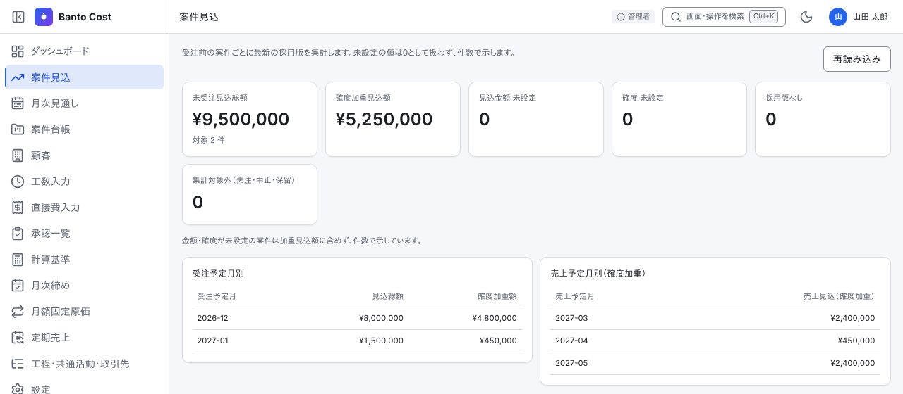

受注前の案件（引合・見積中・交渉中など）を一覧します。各案件の最新の採用版を集計します。

- 上のカード：未受注見込の総額、確度加重額、見込額・確度が未設定の件数、採用版なしの件数。
- 受注予定月別・売上予定月別の表と、案件別の一覧（見込額・確度・確度加重額・受注予定月・売上予定）。
- 見込の登録・更新は、案件の詳細の「案件見込」欄の「新しい版を保存」で行います。段階・見込額・確度・受注予定月・売上予定と根拠を入力します。保存するたびに新しい版になり、過去の版は書き換えません。採用して保存するには根拠が必要です。
- 見込額・確度が未設定の案件は0として扱わず、件数で示します。

### 月次見通し

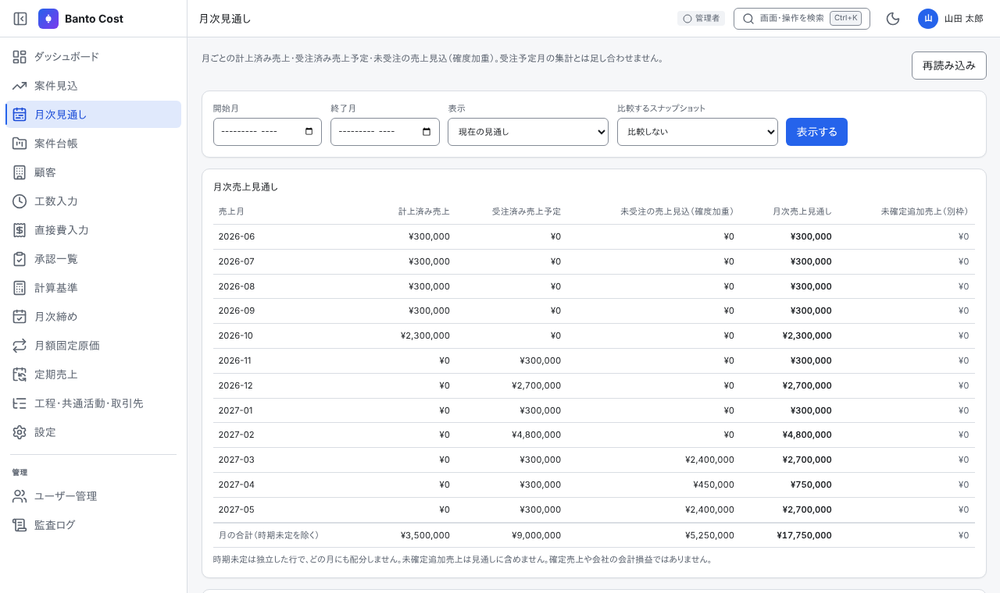

月ごとの売上見通しを、**計上済み売上・受注済み売上予定・未受注の確度加重見込**に分けて表示します。

- 開始月・終了月を選んで「表示する」を押します。「今期」を押すと今の期（例：第13期なら2026年6月〜2027年5月）を表示します。
- **スナップショット**：現在の見通しを名前をつけて保存します（例：「10月報告」）。後で受注や計上があっても保存した金額は変わらないので、「比較するスナップショット」で前回報告との差を確認できます。

### 工数入力

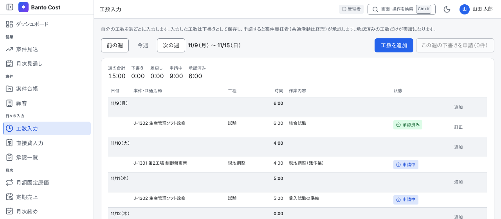

自分の工数を週ごとに入力します。

1. 「前の週」「今週」「次の週」で週を選びます。
2. 日付の行の「追加」または「工数を追加」で、案件（または共通活動）・工程・時間・作業内容を入力して保存します。この時点では下書きです。
3. 「この週の下書きを申請」で申請します。案件の責任者（共通活動は経理）が承認すると実績になります。
   自分で承認もできる工数（自分が責任者の案件、経理なら共通活動も）には「申請して承認」が出て、申請と承認を続けて行えます。週の上の「この週を申請して承認」はその週の分をまとめて行います（「単価未登録」の工数は含めないので、1件ずつ確認して操作します）。承認は自己承認として監査ログに残ります。
4. 差し戻された工数は直して再申請します。承認済みの工数を直すときは、理由をつけて「訂正」を申請します。

上の欄に、週の合計・下書き・差戻し・申請済み・承認済みの時間が出ます。労務原価は「承認済みの工数 × 時間原価単価」です。作業日に適用される時間原価単価がまだ登録されていない工数には「単価未登録」と出て、週の上に注意が出ます（申請は止めません）。

### 直接費入力

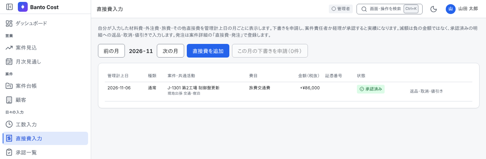

自分が入力した直接費を、管理計上日の月ごとに表示します。「直接費を追加」で登録し、「この月の下書きを申請」で申請します。発注にひもづく実績化や仮計上の確定は、案件の詳細の「直接費・発注」欄から行います。

### 承認一覧

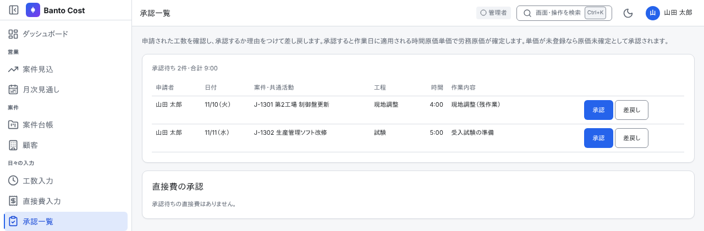

申請された工数と直接費を確認して、「承認」または「差戻し」（理由が必要）を押します。承認すると、作業日に有効な時間原価単価（案件ごとの上書きを含む）で労務原価が決まります。単価が未設定の場合は承認後も「原価未確定」として残り、0円にはしません。原価未確定の工数は（案件の工数なら）その案件の精算完了を止め、直すには1件ずつ訂正と再承認が要ります。そのため、承認の前に単価が引けない行には「単価未登録」と表示し、上に件数と計算基準へのリンクを出します。その行の「承認」は確認のうえで実行します（月額固定で払う人など、単価がないのが正しい場合もあるので止めはしません）。

「表示中をすべて承認」は、表示されている工数（「単価未登録」の行を除く）または直接費を1件ずつ順に承認します。承認できなかった行（締め済みの月など）は理由を表示して一覧に残り、ほかの行の承認は続けます。

### 計算基準

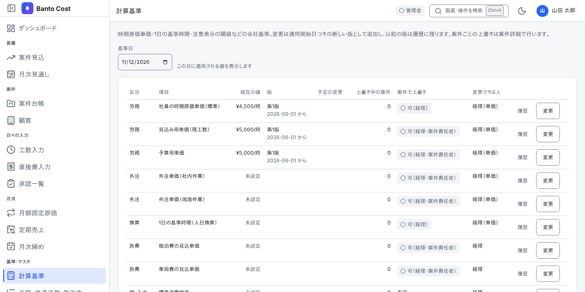

時間原価単価・予算用単価・見込み用単価・外注単価・1日の基準時間・目標粗利率などの会社の基準です。

- 基準日を選ぶと、その日に有効な値が表示されます。
- 「変更」で新しい値と**適用開始日**・理由を登録します。値は版で残り、過去の値は「履歴」で確認できます。
- 案件ごとに値を変えたいときは、案件の詳細の「計算基準」欄で上書きします（「上書きできる人」の列を参照）。
- 承認済みの実績や採用済みの見込は、基準を変えても自動では書き換わりません。

### 月額固定原価

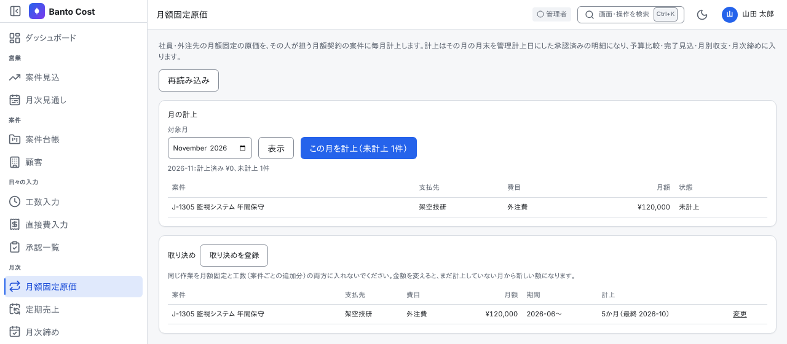

社員や外注先に毎月決まった額を払う場合の原価です。

1. 「取り決めを登録」で、案件・支払先・費目・月額・期間を登録します。
2. 「月の計上」で対象月を選び「この月を計上」を押すと、その月末を管理計上日にした承認済みの明細が案件に入ります。同じ月を二重に計上することはありません。

社員分は労務費、外注先分は外注費として予算比較・完了見込・月別収支に反映されます。

### 定期売上

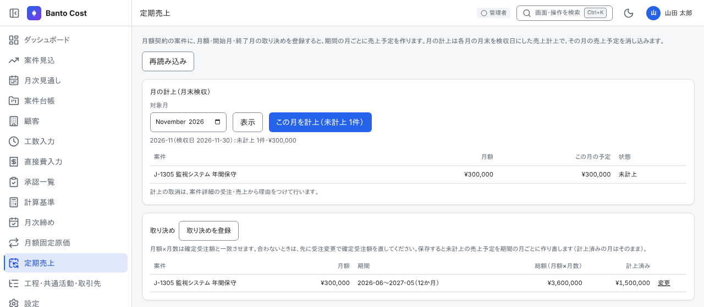

年間保守などの月額契約の売上です。

1. 案件を受注転換してから、「取り決めを登録」で案件・月額・開始月〜終了月を登録します。月額×月数は確定受注額と一致させます。保存すると、未計上の月ごとの売上予定が作り直されます。
2. 「月の計上」で対象月を選び「この月を計上」を押すと、月末を検収日にした売上計上が一度だけ行われます。

### 月次締め

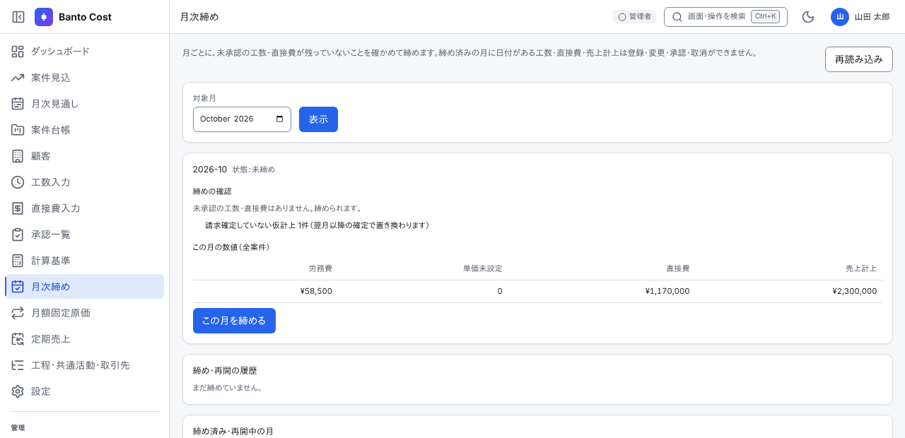

月ごとに、未承認の工数・直接費や未計上の売上が残っていないかを確かめて締めます。

1. 対象月を選んで「表示」を押すと、締めの確認（残っている作業）とその月の数値（労務費・直接費・売上計上）が表示されます。
2. 問題がなければ「この月を締める」を押します。
3. 締めた月に日付がある工数・直接費・売上計上は、登録・変更・承認・取消ができません。直す必要があるときは、理由をつけて「再開」し、直してから再度締めます。締めた時点の数値と今の数値は比べられます。

### 工程・共通活動・取引先

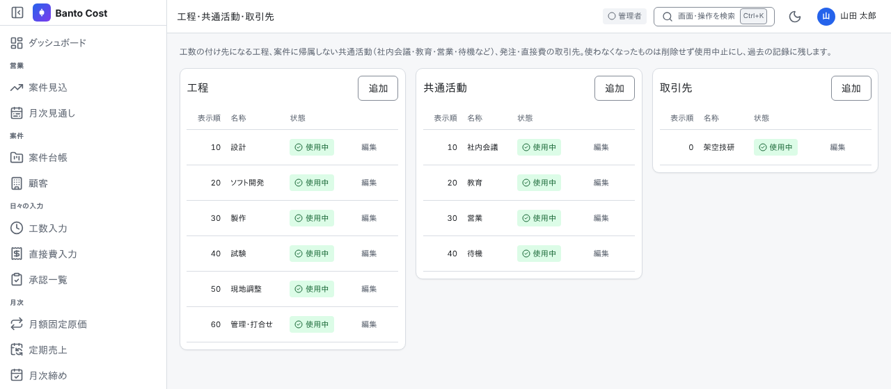

工数入力で選ぶ**工程**と**共通活動**（案件に属さない社内会議・教育など）、発注・直接費で選ぶ**取引先**を管理します。使わなくなったものは削除せず「使用中」を外します。

### ユーザー管理・監査ログ・設定

- **ユーザー管理**（管理者のみ）：利用者の追加、ロールの変更、[業務の能力](#能力の付け方)の設定、パスワードの再設定。
- **監査ログ**（管理者のみ）：誰がいつ何をしたかの記録。金額は記録しません。
- **設定**：外観・言語、アカウント（パスワード変更）、サーバ・接続（社内LANでの共有）、データ管理（バックアップ）、セキュリティ。

## 計算のきまり

- **金額**は円の整数、**工数**は分の整数で扱います。金額は税抜です。
- **未設定は0にしない**：単価・見込額・確度などが未設定のときは「未設定」と表示し、0円・0%として計算しません。利益率の分母が0のときは「算出不可」です。
- **年度**は6月開始で、期番号で表示します（第13期＝2026年6月〜2027年5月）。月の欄の見出しには、その月の期（例：「対象月（第13期）」）を添えます。
- **今日の日付**（業務日付）は日本時間（Asia/Tokyo）で決めます。パソコンやサーバーの時刻の設定が違っても、見込の基準日・精算完了日・既定の月は日本時間の今日になります。
- **確度加重額** ＝ 見込額 × 確度。
- **労務原価** ＝ 承認済みの工数 × 時間原価単価（作業日に有効な単価を、承認のときに決めて記録します）。
- **原資** ＝ 確定受注額 − 目標粗利（目標粗利 ＝ 確定受注額 × 目標粗利率、円未満切り捨て）。率は案件の最初の検収日（売上計上日）のものを使います。
- **完了見込原価** ＝ 基準日までの実績 ＋ 発注済み未実績 ＋ 残原価見込み。
- **完了見込直接利益** ＝ 確定受注額 − 完了見込原価。共通費は配賦していないので、会社の営業利益ではありません。
- **（暫定）**：未承認・仮計上・単価未設定の実績が含まれている数値に付きます。

## 権限（能力）

画面に出る内容は、ロール（管理者・編集者・閲覧者）に加えて、利用者ごとの**能力**と**案件の範囲**（責任者・営業担当・作業者）で決まります。管理者でも能力がなければ金額は見えません。

| 画面での名前     | 能力             | できること                             |
| ---------------- | ---------------- | -------------------------------------- |
| 工数・経費の入力 | `time.entry`     | 自分の工数・経費の入力・申請           |
| 案件見込の更新   | `pipeline.edit`  | 担当営業案件の見込の更新・採用         |
| 案件の管理       | `project.manage` | 担当案件の予算案・残見込・承認         |
| 単価の管理       | `finance.rate`   | 時間原価単価の閲覧・登録               |
| 経理             | `finance.close`  | 売上計上・費用確認・月次締め・訂正承認 |
| 全体レポート     | `report.all`     | 全案件の集計と明細の閲覧               |
| 金額の閲覧       | `amount.view`    | 金額の閲覧                             |

### 能力の付け方

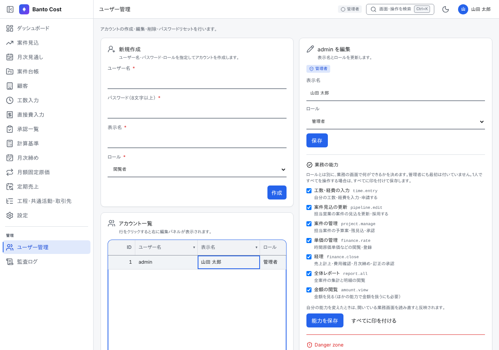

1. 管理者でログインし、サイドバーの「ユーザー管理」を開きます。
2. アカウント一覧で能力を付ける利用者の行をクリックします。右に編集パネルが出ます。
3. 「業務の能力」で付けたい能力に印を付け、「能力を保存」を押します。1人ですべてを操作する場合は「すべてに印を付ける」を押してから保存します。
4. 自分の能力を変えたときは、開いている業務画面を読み直すと反映されます。

承認は自分で行えます（自己承認として監査ログに残ります）。能力の変更も監査ログに残ります。

## 困ったとき

| 症状                                           | 確認すること                                                                         |
| ---------------------------------------------- | ------------------------------------------------------------------------------------ |
| 金額が表示されない・「権限がありません」と出る | 利用者に `amount.view` と、必要な能力が付いているか                                  |
| 労務費が「単価未設定」になる                   | [計算基準](#計算基準) に、その日に有効な時間原価単価があるか                         |
| 「見込更新要」と表示される                     | 採用中の見込版の基準日より後に実績が入った。新しい見込版を作る                       |
| 数値に「（暫定）」が付く                       | 未承認の工数・直接費や仮計上が残っている。[承認一覧](#承認一覧) や請求確定を済ませる |
| 工数や直接費を保存できない                     | その月が[締め済み](#月次締め)でないか                                                |
| 精算完了にできない                             | 表示される未処理（未承認・仮計上・未計上の売上残）を先に処理する                     |

## 開発者向け

開発の状態・文書・計算規則・開発環境は [docs/project/development.md](docs/project/development.md) にまとめています。仕様は [docs/project/spec.md](docs/project/spec.md)、設計案は [docs/project/design.md](docs/project/design.md) です。

本アプリは [Banto](https://github.com/tyaro/banto) v6.10.0 をコピーして作成し（`standard` プリセット）、v7.0.0 の変更を取り込んでいます。個人用の Banto Business とはアプリ・業務データを分けています。

会社の実データ（Excel の売上一覧・収支計算・外注請求・作業報告など）はリポジトリに入れません。`private/` と `*.xlsx` 等は `.gitignore` 済みです。説明書の画面画像も架空のデータで撮影しています（撮り直しの手順は [docs/assets/manual/README.md](docs/assets/manual/README.md)）。
