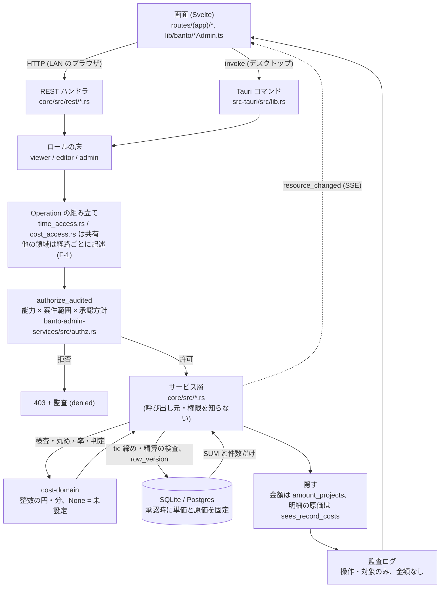

# デザイン・UX・データ設計レビュー（2026-11）

作成日: 2026-11-12
対象: main `f45e716`（v0.1.0-beta.1 以降、PR #39 まで）
状態: **評価の記録**。コードは変更していない。改善は §8 の順に、小さな PR に分けて判断する。
位置づけ: banto-cost を「業務アプリとして使えるか」の目で、デザイン／UI、UX、データの持ち方、
データの流れ、仕様・設計案とのずれの5観点から点検した。

トラック: 本書は**保守者向け（トラックA）**。
関連: [仕様書](../project/spec.md)、[設計案](../project/design.md)、[conventions](../conventions.md)、
[ADR-0028](../adr/0028-capability-project-scope-authz.md)。

確認の方法と限界:

- コード・マイグレーション・文書を読んで評価した。**画面は動かしていない**（スクリーンショットも
  撮っていない）。操作の手数（§3）はコードから数えたもので、実機の感触ではない。
- 手元で走らせたのは `cargo test -p cost-domain`（153 件すべて成功）だけ。`pnpm check`・
  `pnpm e2e`・Postgres のテストは走らせていない。`src-tauri` はこの環境でコンパイルできない。
- `private/` は読んでいない。本書の金額・名前はすべて架空。
- 「推測」と書いた箇所は、コードで裏を取っていない見立て。

---

## 1. 概要

### 1.1 総評

計算とデータの土台は堅い。金額は円の整数、工数は分の整数、未設定は `NULL`／`None`、利益率の
分母0は「算出不可」という規則が、ドメイン層・スキーマ・画面の3か所で一貫している。計算基準の
版管理、承認時の単価の固定、締め・精算・訂正の取消経路もそろっている。

弱いのは**画面のまとめ方と、1人で使うときの手数**である。機能を段階ごとに足した結果、案件詳細は
10 個の節が縦に並ぶ1ページになり、サイドバーは業務 13 項目が平らに並ぶ。入力→申請→承認は
複数人の運用を前提にした3手のままで、利用者1人という決定（STATUS.md §5）と合っていない。
さらに、未決の「社員の時間原価単価」が決まらないまま工数を承認すると、後から直しにくい状態が
残る。使い始める前にここを塞ぐのが最優先。

### 1.2 重要度の上位5件

| 順 | 重要度 | 指摘 | 節 |
| --- | --- | --- | --- |
| 1 | 高 | 単価未設定のまま承認した工数は「原価未確定」で固定され、1件ずつの訂正でしか直せず、精算完了も止める。社員単価が未決の現状でそのまま踏む | §3.2 U-1 |
| 2 | 高 | 1人運用なのに工数・直接費は「下書き→申請→承認」を画面をまたいで1件ずつ行う。一括承認がない | §3.2 U-2 |
| 3 | 高 | 案件詳細が 10 節の縦積みで、目次・タブ・利益の要約がない。基本情報を保存すると一覧へ戻される | §2.2 D-1 |
| 4 | 中 | 年度（6月開始・第13期）が Rust の定数と TypeScript に二重に固定され、期番号の表示は一部の画面だけ | §3.2 U-5、§6 |
| 5 | 中 | REST と Tauri で認可の「配線」が二重。機械検査は対の存在とロールまでで、同じ `Operation` を渡しているかは見ていない。Tauri 側は 13,210 行の1ファイルで手元ではコンパイルできない | §5.2 F-1 |

受注転換に取消がないこと（§3.2 U-3）、直接費の台帳が壊れた行を黙って落とすこと（§4.2 M-2）も
上位に近い。

---

## 2. デザイン／UI

### 2.1 良い点

- **未設定・算出不可の表示が規則どおり。** `formatYen`・`formatPct` は `null` を「未設定」に
  （`apps/admin-template/src/lib/banto/costFormat.ts:16-24`）、利益率は千分率を受け取り
  `null` を「算出不可」にする（`forecastFormat.ts:10-15`）。画面で率を計算していない。
- **表のアクセシビリティの基本ができている。** `<caption>`・`scope="col"`・数値列の `.num` を
  そろえている（例 `routes/(app)/projects/[id]/ForecastSection.svelte:404-447`）。エラーは
  `role="alert"`、状態は `role="status"`（同 `:299`、`:386`）。
- **読み込み・権限なし・失敗・空の4状態を区別している。** 案件詳細は「見つからない／権限がない／
  読み込み失敗（再読み込みつき）／読み込み中」を出し分ける
  （`routes/(app)/projects/[id]/+page.svelte:161-187`）。ダッシュボードも読めない集計を0円に
  せず「権限がありません」と書く（`messages/ja.json:115-117`）。
- **確定度の注記がある。** 途中実績の注記、暫定・不足あり、見込更新要のバッジを完了見込の見出しに
  出している（`ForecastSection.svelte:380-400`）。仕様 7.2・6.6 のとおり。
- 色・余白はおおむねテーマのトークン（`var(--banto-*)`）で書かれている。

### 2.2 問題点

**D-1（高）案件詳細が1ページに 10 節の縦積み。**

- 根拠: `routes/(app)/projects/[id]/+page.svelte:228-302`。基本情報のフォームの下に、受注・売上、
  案件見込、計算基準、予算、完了見込、精算完了、月別収支、直接費・発注、工数が無条件に並ぶ。
  節の合計は 6,000 行を超える（`OrderSection` 878、`CostsSection` 887、`ForecastSection` 887、
  `PipelineSection` 771、`BudgetSection` 714 行など）。ページ内の目次・タブ・折りたたみはない。
- 影響: 日常の「この案件はいくら儲かるか」を見るのに、編集フォームを越えて完了見込の節まで
  スクロールする。未保存の検知も 8 つの節の状態を束ねており（`+page.svelte:72-105`）、どの節が
  未保存かは利用者に見えにくい。節はそれぞれ独立に読み込むので、開くたびに API を 9 本前後呼ぶ
  （推測。計測していない）。
- 設計案とのずれ: 設計案 5 章は「売上段階・予算版・完了見込・明細・履歴の**タブ**」。
- 改善案: (a) 先頭に要約の帯（確定受注額・現在予算・実績原価・完了見込利益と率・注意表示）を
  置く。数値は既存の `ForecastOverview` で足りる。(b) 節をタブか、少なくともページ内リンクの
  目次にする。受注前は「見込・受注転換」、受注後は「利益・予算・実績」を既定で開く。(c) 基本情報の
  編集は「編集」ボタンで開く形にして、普段は閉じる。

**D-2（中）基本情報を保存すると一覧へ戻る。**

- 根拠: `routes/(app)/projects/[id]/+page.svelte:146`（保存成功で `goto('projects')`）。
  新規登録も同じ（`routes/(app)/projects/new/+page.svelte:56`）。
- 影響: 状態を「進行中」「作業完了」に変えるたびに一覧へ戻され、続き（予算・精算完了）のために
  案件を開き直す。新規登録の直後も、見込の入力のために一覧から探して開く。
- 改善案: 保存後はその案件の詳細にとどまる（新規は作った案件の詳細へ進む）。顧客台帳の型を
  そのまま写したことによる副作用と見る。

**D-3（中）サイドバーが業務 13 項目の平らな並びで、仕事の順になっていない。**

- 根拠: `src/lib/navigation.ts:100-147`。ダッシュボード、案件見込、月次見通し、案件台帳、顧客、
  工数入力、直接費、承認一覧、計算基準、月次締め、月額固定原価、定期売上、工程・共通活動が
  一列。区切りは「管理」（ユーザー・監査ログ）だけ（`navSections`、同 `:173-184`）。
- 影響: 毎日使う画面（工数・直接費・承認）と、月に一度（締め・月額固定・定期売上）、まれにしか
  使わない設定（計算基準・マスタ）が同じ重さで並ぶ。
- 改善案: 「営業（見込・見通し）／案件（台帳・顧客）／日々の入力（工数・直接費・承認）／月次
  （月額固定・定期売上・締め）／設定（計算基準・マスタ）」の見出しで分ける。`navSections` に
  区分を1つ足すだけで済む（scaffold のアンカーに触れないよう `CostNav*` 側で足す）。

**D-4（中）ナビと画面が能力（capability）を知らない。**

- 根拠: `GET /api/authz/me` はあるが（`core/src/rest/mod.rs:26`）、画面側から呼んでいる箇所が
  見つからない（`src/` を `authz/me`・`authz_me` で検索して該当なし）。ナビの出し分けは
  `adminOnly` だけ（`navigation.ts:67`、`:178-182`）。各節は「サーバーが断ったら通知する。
  推測で隠さない」方針（`OrderSection.svelte:12-16`）。
- 影響: 1人運用では全能力が付くので実害はない。2人目（例: 入力担当）を足すと、開けない画面が
  ナビに並び、押してから断られるボタンが残る。
- 改善案: 2人目を足す前に、`authz/me` を起動時に読んでナビとボタンの出し分けに使う。判定の正は
  サーバーのまま（表示の都合だけに使う）。

**D-5（中）確認が `window.confirm` で 26 か所。**

- 根拠: 採用・承認・受注転換・精算完了・締めなど取り返しにくい操作も含む
  （`ConversionForm.svelte:173`、`CloseoutSection.svelte:151,198`、`BudgetSection.svelte:222`、
  `ForecastSection.svelte:233`、`closing/+page.svelte:88,103`、`fixed-costs/+page.svelte:190`
  ほか）。共有部品には `Modal`・`OverlayPanel` がある（`packages/ui/src/`）。
- 影響: ブラウザ既定のダイアログは、何が変わるか（金額・版・月）を整形して見せられず、テーマにも
  合わない。デスクトップ版（WebView）での見え方は実機で未確認。
- 改善案: 「取り返しにくい操作」だけ先に `Modal` へ移し、対象（案件コード・金額・月）と
  「取り消せるか」を本文に書く。入力破棄の確認は後回しでよい。

**D-6（低）日付・月の入力が素の `<input type="date|month">`。**

- 根拠: 業務画面の約 30 か所（`PipelineSection.svelte:455-546`、`outlook/+page.svelte:141-145`、
  `closing/+page.svelte:162` など）。スキーマ駆動フォーム側は `@banto/ui` の `DateInput` を使う
  （`src/lib/components/FormDateInput.svelte`）。
- 影響: 同じアプリで日付の入力部品が2種類になる。`type="month"` は対応しないエンジンでは
  ただのテキスト欄になる（`placeholder="YYYY-MM"` で備えてはいる）。Windows の WebView2 では
  動く見込みだが未確認。
- 改善案: 月の入力部品を1つ作り、期番号を添えて表示する（§3.2 U-5 と同時に）。

**D-7（低）金額の書式の細部。**

- `formatYen` は負の値を `¥-100,000`、`formatSignedYen` は `-¥100,000` と書く
  （`costFormat.ts:18`、`:108-113`）。赤字の利益は前者で出る（`ForecastSection.svelte:351-353`）。
- `toLocaleString()` にロケールを渡していないので、桁区切りは実行環境の地域設定に従う。
- 「未設定」と「—」が混在する（権限で見えない・該当なしは「—」、値がないは「未設定」）。
  使い分けは筋が通っているが、凡例がどこにもない。
- 改善案: 負の円は `-¥` に統一、`toLocaleString('ja-JP')` に固定、凡例を取説に1行足す。

**D-8（低）業務画面の見た目・アクセシビリティが自動検査の対象外。**

- 根拠: axe の対象はダッシュボード・顧客・設定・ログインだけ（`e2e/visual/a11y.spec.ts:26-36`）。
  E2E の smoke も顧客とダッシュボードまで（`e2e/tests/smoke.spec.ts`）。
- 改善案: §3.2 U-7 と合わせて、主要な流れ1本を E2E にし、その途中の画面を axe に通す。

---

## 3. UX

### 3.1 主要業務の流れと手数（利用者1人。コードから数えた）

| # | 業務 | 画面 | 手数の目安 | 戻せるか |
| --- | --- | --- | --- | --- |
| 1 | 顧客登録 | `/customers/new` | 入力→保存 | 編集可 |
| 2 | 案件登録 | `/projects/new` | 入力→保存→**一覧に戻る→案件を開く** | 編集可 |
| 3 | 案件見込 | 案件詳細・案件見込 | 版を保存→採用（確認） | 新しい版で上書き |
| 4 | 受注転換 | 案件詳細・受注・売上 | 受注日・金額・根拠・予定日・売上予定を入力→確認 | **取消なし**（U-3） |
| 5 | 計算基準 | `/calc-basis` | 項目ごとに 入力→影響を確認→保存 | 追加のみ（新しい版） |
| 6 | 予算 | 案件詳細・予算 | 下書き作成→行入力→保存→承認（確認） | 変更は版2以降 |
| 7 | 状態を進行中へ | 案件詳細・基本情報 | 状態を選ぶ→保存→**一覧に戻る** | 受注〜作業完了の間は可 |
| 8 | 工数 | `/time`→`/approvals` | 入力（下書き）→申請（週まとめ可）→**別画面で1件ずつ承認** | 訂正申請→再承認 |
| 9 | 直接費 | `/costs`→`/approvals` | 入力→申請→別画面で1件ずつ承認 | 調整（返品・取消・値引） |
| 10 | 月額固定原価 | `/fixed-costs` | 取り決め登録（初回）→月を選ぶ→この月を計上 | 取消（理由） |
| 11 | 売上計上 | 案件詳細／`/recurring-revenue` | 計上日・金額→計上 | 取消（理由） |
| 12 | 完了見込 | 案件詳細・完了見込 | 下書き作成→残を入力→保存→採用（確認） | 新しい版 |
| 13 | 月次締め | `/closing` | 月を選ぶ→阻害を確認→締め（確認） | 再開（理由） |
| 14 | 精算完了 | 案件詳細・基本情報→精算完了 | 状態を作業完了に→保存→開き直す→残額に理由→精算完了 | 取消（理由） |

1案件を通すと、案件詳細を少なくとも3回開き直す（#2・#7・#14）。日々の工数は1件につき
3手・2画面。

### 3.2 問題点

**U-1（高）単価未設定のまま承認した工数が直しにくい。**

- 根拠: 承認は単価がなくても通り、`labor_cost` は `NULL` で確定する
  （`core/src/time_entries.rs:1146-1158`、`migrations-sqlite/0014_time_entries.sql:39-42`）。
  承認後の通知は「承認しました（単価が未登録のため原価未確定です）」だけ
  （`messages/ja.json:1159`）。精算完了はこれを阻害項目にする
  （`crates/cost-domain/src/closeout.rs:124-126`）。直す手段は1件ずつの訂正申請と再承認だけ
  （STATUS.md §8「P6a 既知」）。計算基準を後から登録しても、影響の確認は訂正候補を**件数**で
  見せるだけで、一覧も一括の再計算もない（`src/lib/components/CalcBasisForm.svelte:242`、
  `core/src/calc_basis.rs:175`）。
- 影響: 「社員の時間原価単価」は未決（STATUS.md §4）。決まる前に試行で工数を承認すると、
  その全件が原価未確定で残り、案件を精算完了にできない。月 20 日 × 数件でも数十件の訂正になる。
  T04（0円にしない）は守れているが、運用が詰まる。
- 改善案（小さい順）:
  1. 承認の前に止める: 承認待ちの一覧で、単価が引けない行に「単価未登録」を出し、承認ボタンの
     確認文に含める。計算基準が空のうちは `/time`・`/approvals` の上部に注意を出す。
  2. 設計案 10.5 の「再計算訂正の候補」を一覧にし、選んだ行をまとめて訂正・再承認できるように
     する（訂正の規則 `cost_domain::time::check_correction` はそのまま使える）。
  3. 「社員は月額固定で計上し、工数には単価を掛けない」運用を選ぶなら（§9.2）、その場合の
     精算完了の扱い（単価なし工数を阻害にしない）を仕様として決める。黙って0円にはしない。

**U-2（高）1人運用で 申請→承認 が重い。**

- 根拠: 工数は下書きで保存し（`time/TimeEntryForm.svelte:5-6`）、週まとめの申請はあるが
  （`time/+page.svelte:218`）、承認は別画面で1件ずつ（`approvals/+page.svelte:78,198`、
  `CostApprovals.svelte:63`）。一括承認・選択承認はない。`/time` から `/approvals` へのリンクも
  ない。一方、月額固定原価は「操作するのは1人なので、計上がそのまま承認済み」（設計案 9.4.2）。
- 影響: 自分で入れて自分で承認するために、毎週 画面を移り、件数ぶん押す。月額固定との扱いの差も
  説明しにくい。
- 改善案: 状態の遷移とデータは変えずに、(a) 承認一覧に「表示中をすべて承認」（単価未登録の行は
  除いて件数を示す）、(b) 本人が承認権限も持つときだけ `/time` に「申請して承認」を出す。
  どちらも既存の `submit`→`decide` を順に呼ぶだけで、監査の `selfApproval` もそのまま残る。
  「承認の流れを新しく作らない」という運用ルール（STATUS.md §5）にも反しない。

**U-3（中）受注転換を取り消せない。**

- 根拠: `OrdersService` の操作は `convert`・`request_change`・`decide_change`・`replan`・
  `recognize`・`cancel_recognition` で、転換の取消がない（`core/src/orders.rs:892-1415`）。
  状態も受注済みから受注前へは戻せない（`crates/cost-domain/src/project.rs:98-108`）。
  `order_conversions.project_id` は UNIQUE（`0011_orders.sql:19`）。
- 影響: 案件を取り違えて転換すると、金額は受注変更で直せても、「受注済み」という状態と受注日は
  残る。確認は `window.confirm` 1回（`ConversionForm.svelte:173`）。精算完了と月次締めには
  取消があるのに、ここだけ一方通行。
- 改善案: 売上計上・予算・実績がまだ無い転換に限り、理由つきで取り消せるようにする（精算完了の
  取消 `closeout_reopenings` と同じ形）。当面は確認ダイアログに案件名・金額・「取り消せません」を
  明記する（D-5）。

**U-4（中）ダッシュボードが利益と「今日やること」を見せていない。**

- 根拠: 要約は未受注見込・確度加重額・今月と来月の売上見通し・注意が必要な案件の4種
  （`messages/ja.json:105-114`）。注意の件数は見込と売上予定の不備だけで
  （`src/lib/banto/dashboardSummary.ts:36-50`）、完了見込赤字・予算超過見込み・見込更新要
  （`cost_domain::alerts`）は全体一覧まで行かないと見えない。承認待ち・未計上の月額固定・
  締めていない月も出ない。
- 影響: アプリの目的（案件の利益管理）の答えが最初の画面にない。
- 改善案: `GET /api/portfolio` の注意表示を数えて「赤字見込み n 件・予算超過見込み n 件・
  見込更新要 n 件」を足し、承認待ち件数と「今月の月額固定／定期売上が未計上」を並べる。
  どれも既存の API で取れる（推測。応答の形は確認したが呼び出しの重さは測っていない）。

**U-5（中）期番号の扱いが画面によって違う。**

- 根拠: 期を表示するのは月別収支（`MonthlySection.svelte:174`）と直接費の月別
  （`CostsSection.svelte:335`）、CSV の条件だけ。月次見通し・月次締め・月額固定・定期売上の月の
  選択は `YYYY-MM` のみ。期別 CSV の期の指定は素の数値欄（`projects/+page.svelte:357`、
  1〜999）で、その期が何年何月かは出ない。
- 影響: 「第13期の累計」を見たいとき、利用者が頭の中で 2026-06〜2027-05 に直す。5月と6月の
  境目で取り違えやすい。
- 改善案: 月の入力・表示に「2026-11（第13期）」と添える共通の書式を1つ作る。期の選択は
  「第13期（2026年6月〜2027年5月）」の選択肢にする（ラベルは `FiscalCalendar::label` が
  すでに作れる、`crates/cost-domain/src/calendar.rs:186-192`）。月次見通しに「今期」の
  範囲指定を足す。

**U-6（低）工数の入力単位が欄から分からない。**

- 根拠: 時間・分の欄は `step="1"`（`time/TimeEntryForm.svelte:301-317`）。入力単位
  （計算基準 `time_unit`）はサーバーが保存時に検査する（`core/src/time_entries.rs:751`）。
- 影響: 15 分単位の会社で 10 分と入れると、保存してから断られる。
- 改善案: フォームを開くときに単位を読み、分の欄を選択肢（0・15・30・45）にする。未設定なら
  今のまま。

**U-7（中）主要な業務の流れを通す自動テストがない。**

- 根拠: E2E は顧客とダッシュボードまで。工数・直接費・精算完了の取消の画面は「E2E 対象外」
  「手元で表示確認していない」（STATUS.md §8）。サービス層と REST のテストは厚い
  （`core/src/rest/tests.rs` 6,231 行）。
- 影響: 画面の配線の崩れ（特に Tauri 経路）は、利用者が踏むまで分からない。
- 改善案: 架空の1案件で #2〜#14 を通す E2E を1本。U-2・D-2 を直す前に書くと、手数が減ったことも
  確かめられる。

---

## 4. データの持ち方

### 4.1 良い点

- **型と未設定の区別。** 金額・工数は `INTEGER`（Postgres は `BIGINT`）。見込額・確度・単価・
  労務原価は `NULL` を許し、0 と区別する（`0010_projects.sql:48-53`、`0014:59-60`）。計算基準は
  値を初期登録しない（`0013_calc_basis.sql:6-8`）。
- **状態と値の組を CHECK で縛っている。** 承認済みでなければ `labor_cost`・`applied_rate` は
  `NULL`（`0014:71`）。予算・完了見込は 下書き＝版番号なし・合計なし、承認／採用＝すべてあり
  （`0015:33-36`、`0017:45-50`）。月額固定は支払先の種類と費目の対応（`0023:30-33`）。
- **一度きりを部分一意索引で守る。** 下書きは案件に1つ（`0015:40-41`、`0017:54-55`）、
  仮計上の確定は1回（`0016:107-108`）、訂正は1件に1つ（`0021:17-18`）、月額固定は取り決め×月に
  1つ（`0023:60-61`）。再送の二重登録は `client_request_id`（`0014:74`、`0016:41,105`）。
- **計算基準は追加のみ。** 版と適用開始日の一意索引（`0013:61-64`）、案件の上書きの解除は
  値なしの行（T34）。承認時に使った行の ID と値を明細に残す（`0014:58-60`、`0015:54-55`、
  `0017:28-29`）。
- **発注は原価ではなく約束。** 実績化済み額は保存せず、承認済みの直接費から求める
  （`0016:16-21`）。T05 の二重加算が構造的に起きない。
- **確定受注額も保存しない。** 転換額＋承認済みの受注変更から求め、`revenue_version` で
  行き違いを拒否する（`0011_orders.sql:5-12`）。
- **取消は行を残す。** 売上計上・月額固定・精算完了・締めは、取消の理由と実行者を持つ。
  マスタは無効化で残す。

### 4.2 問題点

**M-1（中）日付・月が `TEXT` で、形式を DB が検査しない。**

- 根拠: `work_date`・`booked_on`・`recognized_on`・`valid_from`・各 `month` は `TEXT NOT NULL`
  だけ（`0014:48`、`0016:84`、`0011:69`、`0013:48`、`0023:22-23,46`）。形式の検査があるのは
  `closing_periods.month` の長さ 7 だけ（`0020:12`）。締めの判定は先頭 7 文字の切り出し
  （`core/src/closing.rs:73-75`）、月別集計は `SUBSTR(work_date, 1, 7)`
  （`core/src/reports.rs:235`）、期間の比較は文字列の大小。
- 影響: サービス層は必ず `Date::parse` を通すので、通常の経路では壊れない。危ないのは取り込み・
  手作業の SQL・将来の Excel 移行（設計案 9 章）。`2026-6-1` のような行が入ると、比較・月の
  切り出し・締めの判定が静かにずれる。
- 改善案: 新しいマイグレーションで、取り込みの入口になる表から `CHECK (work_date GLOB
  '[0-9][0-9][0-9][0-9]-[0-9][0-9]-[0-9][0-9]')`（Postgres は `~`）を足す。既存の表は SQLite
  では作り直しになるので、まず取り込み処理の側で同じ検査を必須にし、表への追加は移行の段階で
  判断する（タグ以降のマイグレーションは凍結、`verify:migrations`）。

**M-2（中）直接費の台帳が、読めない行を黙って落とす。全社分を毎回読む。**

- 根拠: `ledger_of` は `filter_map(ledger_entry)` で、種別・費目・日付の解釈に失敗した行を
  捨てる（`core/src/direct_costs.rs:540-567`）。`LEDGER_SQL` には案件の絞り込みがなく
  （同 `:531-535`）、案件1つの実績を出すのにも全社の承認済み明細を読む
  （`project_actuals`→`postings`、同 `:1664-1672`、`:1735-1742`）。逆に、台帳の検査
  （`ledger::postings`）が1件でも不整合を見つけると、全案件の画面が「直接費の台帳に不整合が
  あります」で止まる（同 `:1669-1671`）。
- 影響: 落ちた行は実績原価から消え、利益が良く見える方向にずれる。「未設定を0にしない」の
  精神に反する静かな欠落。全社読みは、数年分の明細がたまると案件詳細・全体一覧が遅くなる
  （推測。件数の見積りはしていない）。
- 改善案: (a) `filter_map` をやめ、解釈できない行は件数と ID をエラーまたは注意として返す。
  (b) 案件単位の読み出しは、その案件の行と、その案件に配分・参照でつながる行に絞る。
  (c) 不整合は該当案件だけを「要確認」にし、他の案件は表示する。

**M-3（中）承認済みデータの不変性はサービス層だけが守っている。**

- 根拠: マイグレーションにトリガーはない。承認済みの行を書き換えないことは、`UPDATE … WHERE
  status IN ('draft','returned')` などの条件（`core/src/time_entries.rs:871,1056,1083`）と、
  締め・精算のトランザクション内検査（`refuse_closed!`、`core/src/closing.rs:87-101`）で
  担保している。
- 影響: アプリ経由では十分。SQLite のファイルを直接開く、将来の取り込みスクリプトが `UPDATE` を
  打つ、といった経路には歯止めがない。監査ログにも残らない。
- 改善案: 利用者1人・SQLite の間は現状でよい（判断）。取り込み（§9.4）を作るときは、必ず
  サービス層の関数を通す。複数人・Postgres に広げる時点で、承認済み行の `UPDATE` を拒む
  トリガーを労務原価・直接費・売上計上の3表に足すか検討する。

**M-4（低）責任者を2か所に持つ。`project_members` に外部キーがない。**

- 根拠: `projects.manager_user_id` と `project_members(kind='manager')` をサービスが同期する
  （`0010_projects.sql:14-16`）。`project_members.project_id` は外部キーなし
  （`0009_authz.sql:17-21`、設計案 2.4 に理由）。
- 影響: 認可が読むのは `project_members`、画面が見せるのは `manager_user_id`。同期が外れると
  「責任者なのに開けない」が起きる。SQLite でも表の作り直しをすれば外部キーは足せる。
- 改善案: 起動時か診断画面で、2つのずれと孤児の行を数える検査を1つ持つ。

**M-5（低）売上予定に (案件, 月) の一意制約がない。**

- 根拠: `revenue_plan`（`0011_orders.sql:55-62`）。重複はドメインの検査
  `duplicate_plan_month` で拒否している。
- 改善案: `UNIQUE (project_id, COALESCE(month, ''))` を次に表を触るとき足す。

**M-6（低）監査ログは操作を残すが、値は残さない。記録は処理の外。**

- 根拠: 詳細に金額・単価・理由を入れない方針（設計案 10.8、9.4.2）。監査の記録はサービスの
  トランザクションの後、ハンドラ側で行う（`src-tauri/src/lib.rs:4500-4511`）。行為者は
  ユーザー名の文字列（`0005_audit_log.sql:8`）。
- 影響: 「誰がいつ何をしたか」は追えるが、「いくらからいくらに」は業務表の履歴（版・取消行）に
  頼る。業務表は履歴を持つので実用上は足りる。処理が成功して監査の書き込みだけ失敗する窓は
  残る（Banto の既定の設計）。
- 改善案: 現状維持でよい。取説に「金額の変更前後は各画面の履歴で見る」と書く。

### 4.3 SQLite と Postgres の差

- 型の写しは機械的で一貫している（`INTEGER`→`BIGINT`、0/1→`BOOLEAN`、
  `migrations-postgres/0014_time_entries.sql:1-4`）。ファイル名の対称は機械検査がある
  （`scripts/verify-architecture.mjs` 規則 11）。
- **業務日付の決め方が違う（中）。** 今日の日付は SQLite が `date('now','localtime')`
  （OS の地域設定）、Postgres が `CURRENT_DATE`（接続の `TimeZone`）
  （`core/src/forecasts.rs:545-553`、`core/src/budgets.rs:353-358`）。設計案 8 章の
  「Asia/Tokyo」はどちらにも明示されていない。日本の PC で使う限り問題ないが、サーバーが
  UTC の環境に置かれると、朝9時までの操作が前日扱いになり、月末は締めの月がずれる。
  改善案: 業務日付を出す関数を1つにまとめ、タイムゾーンを設定値（既定 Asia/Tokyo）から決める。
- **時刻の文字列の形が違う（低）。** `datetime('now')`（UTC、秒まで）と `now()::text`
  （マイクロ秒とオフセットつき）（`core/src/customers.rs:57-62`）。画面での表示と並べ替えが
  方言で変わりうる（未確認）。
- 利用者1人・SQLite と決まっているので、Postgres 側は「規約上残す」以上の投資は不要と見る。
  ただし業務表の Postgres テストが CI で走っているかは確認していない（`ci.yml` の
  `storage-postgres` は接続ヘルパ向け）。

---

## 5. データの流れ

### 5.1 良い点

- **計算はドメイン層に閉じている。** 画面で金額を掛け算・割り算している箇所は見つからなかった
  （分の合計と、入力中の売上予定・配分の残りの表示だけ。`time/+page.svelte:140`、
  `PlanLinesEditor.svelte:37`、`costsFormat.ts:64`）。サービス層の SQL は `SUM` と件数だけで、
  丸め・率・判定は `cost_domain` を呼ぶ（例: 承認時の原価は `approval_cost`、
  `core/src/time_entries.rs:1153`）。
- **「集計に数える行」の定義が1か所。** 訂正で置き換わった工数を外す条件は `counts_sql!` に
  まとめ、予算・完了見込・締め・帳票・精算が同じ定数を使う（`core/src/time_entries.rs:68-80`）。
- **認可の判定そのものは1つの関数。** REST も Tauri も `AuthzService::authorize_audited` に
  `Operation` を渡す（`core/src/rest/projects.rs:113-137`、
  `src-tauri/src/lib.rs:3364-3400`）。工数・直接費は「どの `Operation` か」と「何を隠すか」も
  共有の関数にしている（`core/src/time_access.rs:15-66`、`cost_access.rs`）。
- **一覧・CSV は範囲で絞ってから返す。** `visible_projects`・`amount_projects`（設計案 2.4）。
  個人の単価が逆算できる明細の原価は `sees_record_costs` だけに見せる。

### 5.2 問題点

**F-1（中）認可の配線が2経路に重複し、機械検査は一致までは見ていない。**

- 根拠: 「ロールの確認→記録の読み出し→`Operation` の組み立て→判定→サービス→監査→隠す」の
  並びを、REST のハンドラ（`core/src/rest/*.rs`、テストを除き約 4,100 行）と Tauri のコマンド
  （`src-tauri/src/lib.rs` 13,210 行、コマンド 143 個）がそれぞれ書いている。例: 工数の承認は
  `src-tauri/src/lib.rs:4484-4513` と `core/src/rest/time.rs` の対。機械検査（規則 8、
  `scripts/verify-architecture.mjs:394-908`）は対の存在とロールを見るが、渡している
  `Operation`・承認方針・隠し方が同じかは見ない。`src-tauri` は手元でコンパイルできず、
  REST 側のような統合テスト（`rest/tests.rs`）もない。
- 影響: 主に使うのはデスクトップ版（Tauri 経路）なのに、テストが厚いのは REST 経路。片方だけ
  `Operation` を取り違えても CI は通る。T12 が求める「両経路で同じ判定」は、今はレビューで
  守っている。
- 改善案: 工数・直接費でやっている形（`*_access.rs`）を他の領域にも広げ、「入力→`Operation`」
  「結果→隠す」「監査の詳細」を core 側の関数にして両経路から呼ぶ。最終的には
  「判定つきの操作」を core に1つ置き、REST と Tauri は引数の取り出しだけにする。まず
  精算完了・締め・月額固定・定期売上（操作が少ない）から。

**F-2（中）案件メンバーを画面から設定できない。**

- 根拠: API はある（`core/src/rest/mod.rs:29-31`、Tauri `project_members_*`）が、画面側に
  呼び出しがない（`src/lib/banto`・`src/routes` に `members` の参照なし）。
- 影響: 責任者はサービスが自動で入れるので1人運用は動く。担当営業（`sales`）・作業者
  （`worker`）は付けられず、2人目は案件に工数を入れられない（`EnterTime` はメンバーが条件）。
- 改善案: 2人目を足す前に、案件詳細に担当者の節を足す。

**F-3（低）サーバーの文言が日本語固定。**

- 根拠: 検証エラーの文をサービス層が直接書く（`core/src/closing.rs:78-83`、
  `core/src/time_entries.rs:66`）。画面は Paraglide で英語に切り替えられる。
- 改善案: 利用者が日本語だけの間は現状でよい。コードとキーで返す形は、英語の利用者が出てから。

---

## 6. 仕様・設計案と実装のずれ

| # | 仕様・設計案 | 実装 | 重要度 | 扱いの提案 |
| --- | --- | --- | --- | --- |
| G-1 | 年度開始月と基準期は会社設定に持つ（設計案 10.1） | Rust の定数 `COMPANY_DEFAULT`（`crates/cost-domain/src/calendar.rs:144-148`、参照は `core/src/reports.rs:39`・`direct_costs.rs:1836`）と、TypeScript の `periodOf` に同じ数字を直書き（`src/lib/banto/reportsAdmin.ts:124-128`） | 中 | 会社が1つの間は定数でよいが、二重持ちはやめる。期番号はサーバーから返す |
| G-2 | 個人別・等級別の時間原価単価（`target_kind`・`target_id`、設計案 10.4） | `calc_values` に列がない（`0013_calc_basis.sql:43-56`）。単価は会社基準と案件の上書きだけ | 中 | §9.2 の決定待ち。月額固定で足りるなら「作らない」と設計案に書く |
| G-3 | `calc_values` に承認者・承認日（設計案 10.4） | 列なし。登録者だけ | 低 | 1人運用では不要。設計案を実装に合わせる |
| G-4 | 案件詳細はタブ（設計案 5） | 縦積み（D-1） | 高 | §8 の 3 |
| G-5 | 工数入力は週表示（設計案 5） | 週の一覧＋1件ずつのフォーム。表形式の週入力ではない | 低 | 件数が増えたら検討 |
| G-6 | 管理設定は `/admin/*`（設計案 5） | `/calc-basis`・`/work-masters`・`/closing` などトップ階層 | 低 | 設計案を実装に合わせ、ナビの区分で整理（D-3） |
| G-7 | 自己承認は不可が初期案（仕様 4） | 許可し監査に `selfApproval`（2026-11-06 決定） | — | 決定済み。ずれではない |
| G-8 | 承認済みを変えたら「再計算訂正の候補」を一覧に出す（設計案 10.5、T33「件数と明細」） | 件数だけ（U-1） | 高 | §8 の 2 |
| G-9 | 注意表示「未入力」「未精算発注残」ほか（仕様 9） | 「未入力」は未検出（STATUS.md 既知） | 低 | 現状維持 |
| G-10 | 顧客別・責任者別・費目別のレポート（仕様 9） | 案件別・月別だけ（STATUS.md 既知） | 低 | 試行の後に要否を聞く |
| G-11 | 画面・CSV・集計条件では期番号で表示（設計案 10.1） | 一部の画面だけ（U-5） | 中 | §8 の 5 |
| G-12 | 締め日・タイムゾーンは月末・Asia/Tokyo（設計案 8） | タイムゾーンは実行環境まかせ（§4.3） | 中 | 業務日付の関数を1つに |
| G-13 | 完了見込の残に今後の月額固定を含める（暗黙。9.4.2 既知） | 手入力（「それ以外の見込み」） | 中 | §9.3 で扱う |

受入条件 T01〜T38 のうち、ドメイン層のテスト名に番号があるものは 153 件のテストで通っている
（手元で確認）。T16（配賦）は対象外、T18（復元）は試行待ち。T12 の「両経路」は REST のテストで
確かめており、Tauri 経路は構造の一致に頼っている（F-1）。

---

## 7. データの流れ図

読み方:

- 判定（`authorize_audited`）と計算（`cost-domain`）は1か所。重複しているのは、その前後の配線
  （`Operation` の組み立て、隠し方、監査の詳細）で、領域によって共有の度合いが違う。
- 画面は金額を計算しない。受け取るのは整数の円・分・千分率と、未設定を表す `null`。
- 直接費の実績は、承認済みの直接費と月額固定の計上を1つの台帳にして `cost-domain::ledger` に
  渡す。ここで読めない行が落ちる（M-2）。

---

## 8. 優先順位つきの改善提案（小さく着手できる順）

| 順 | 提案 | 対応する指摘 | 規模の目安 | DB 変更 |
| --- | --- | --- | --- | --- |
| 1 | 単価が引けない工数を承認の前に見せる（承認一覧の行と確認文、計算基準が空のときの注意） | U-1 | 小（画面＋一覧の応答に1項目） | なし |
| 2 | 案件の保存後は詳細にとどまる。新規は作った案件の詳細へ | D-2 | 小（2 行） | なし |
| 3 | 承認一覧に「表示中をすべて承認」、`/time` に「申請して承認」（本人が承認できるときだけ） | U-2 | 小〜中（既存の操作を順に呼ぶ） | なし |
| 4 | 案件詳細の先頭に利益の要約、節の目次（のちにタブ） | D-1、G-4 | 中 | なし |
| 5 | 期番号つきの月の表示・選択を共通化。期番号はサーバーから返し、TypeScript の直書きを消す | U-5、G-1、G-11 | 中 | なし |
| 6 | 直接費の台帳で読めない行を落とさず報告する。案件単位の読み出しを絞る | M-2 | 中 | なし |
| 7 | サイドバーを区分で分ける | D-3 | 小 | なし |
| 8 | 取り返しにくい操作の確認を `Modal` に（受注転換・承認・採用・締め・精算） | D-5、U-3 | 中 | なし |
| 9 | 再計算訂正の候補の一覧と一括の訂正・再承認 | U-1、G-8 | 中〜大 | なし |
| 10 | ダッシュボードに利益の注意表示・承認待ち・未計上を足す | U-4 | 中 | なし |
| 11 | 架空の1案件で主要な流れを通す E2E と、業務画面の axe | U-7、D-8 | 中 | なし |
| 12 | 業務日付の関数を1つにし、タイムゾーンを設定から決める | G-12、§4.3 | 小〜中 | なし |
| 13 | 認可の配線を core に寄せる（操作の少ない領域から） | F-1 | 大（分割して） | なし |
| 14 | 受注転換の取消（実績・計上・予算がない場合のみ） | U-3 | 中 | あり（取消の表） |
| 15 | 2人目を足す前の準備: 案件メンバーの画面、能力によるナビの出し分け | F-2、D-4 | 中 | なし |
| 16 | 日付の形式の CHECK、売上予定の一意制約 | M-1、M-5 | 小 | あり |

1〜3 は試行を始める前に済ませたい。1 だけなら半日程度と見る（推測）。13 は急がない。
デスクトップ経路で不具合が出たとき、その領域から寄せる。

やらなくてよいと判断したもの: Postgres 側の作り込み、承認済み行を守る DB トリガー（M-3）、
サーバー文言の多言語化（F-3）、`calc_values` の承認者列（G-3）。利用者1人・SQLite の間は
費用に見合わない。

---

## 9. 未決事項への示唆

STATUS.md §4 の未決について、実装から見た選択肢と、決めるときに影響する箇所を書く。
決定そのものは利用者の判断。

### 9.1 「済」「営業中」「実行中」の定義と売上計上の時点

- 状態の対応は設計案 9.4 で決定済み（営業中＝未受注、確定＝受注、実行中＝進行中、済＝精算完了）で、
  実装の 10 状態（`crates/cost-domain/src/project.rs:9-35`）にそのまま載る。残る論点は
  **「済」をいつ付けるか**。現行の資料には「済でも請求日なし」の行がある（設計案 9.4）。
  アプリの精算完了は、未承認・発注残・未計上の売上が残ると付けられない（T17）。つまり
  アプリの「済」は現行の「済」より厳しい。
- 示唆: (a) 「済」＝精算完了のままにし、移行時に条件を満たさない行は「作業完了」に置く。
  請求・入金はアプリの外（仕様 3.1 のとおり参考情報）。(b) 「請求したら済」としたいなら、
  それは売上計上（検収）であって精算完了ではないので、状態ではなく「売上計上済み」の印を
  全体一覧に出すほうが合う。どちらでもスキーマの変更は要らない。
- 売上計上の時点は「検収時、月額契約は月末」で決定済み。確かめたいのは**検収日が分からない
  過去の案件**の移行で、請求日を検収日の代わりに使うかどうか。目標粗利率の適用日が最初の
  検収日で決まる（`crates/cost-domain/src/funds.rs:29-32`）ので、日付の置き方で原資が変わる。

### 9.2 社員の時間原価単価の決め方（現行は未計上）

本書の最重要の指摘（U-1）に直結する。選択肢は3つ。

| 案 | 内容 | 実装への影響 | 向き不向き |
| --- | --- | --- | --- |
| A | 全員一律の標準単価を1つ決める（例: 4,000円/時） | そのまま動く。`emp_rate` を1行登録するだけ | 個人の給与が逆算されない。精度は粗い |
| B | 社員は月額固定で計上し、工数には単価を掛けない | 月額固定（P7b）は動く。工数は「原価未確定」のまま残り、精算完了を止める。**止めない規則が要る** | 現行の Excel に最も近い。工数は記録だけの位置づけになる |
| C | 個人別単価 | `calc_values` に対象の列を足し、閲覧制限を作る（G-2）。最も大きい | 1人〜数人の会社では、単価＝給与の開示に近くなる |

- 示唆: 設計案 9.4 の「月額固定＋案件ごとの追加分を工数×単価」は A と B の併用にあたる。
  この場合、**月額固定に含まれる作業の工数**と**追加分の工数**を入力時に区別しないと、
  二重計上になる（STATUS.md の既知「検出しない」）。区別の方法は、(i) 月額契約の案件に入れた
  工数は原価0ではなく「月額固定に含む」として集計から外す印を付ける、(ii) 追加分だけを工数に
  入れる運用にする、のどちらか。(ii) なら実装は不要だが、取説に明記し、月額固定の取り決めが
  ある人が同じ案件に工数を入れたとき注意を出す。
- どの案でも、**決まるまでは工数を承認しない**（下書き・申請で止める）のが安全。§8 の 1 は
  そのための歯止め。
- **決定（2026-11-12 ユーザー）**: 社員の時間原価単価が決まるまで、工数は承認しない運用とする
  （下書き・申請で止める）。

### 9.3 外注先の月額固定払いの契約内容

- 現在の実装は「1つの取り決め＝1案件・1支払先・月額・期間」で、配分なし
  （`0023_fixed_costs.sql:14-35`）。確認したいのは次の3点。
  1. 1人の外注先が**複数の案件**にまたがって働く月があるか。あるなら、案件ごとに取り決めを
     分けて月額を割るか、直接費の配分（T10、`cost_allocations`）に寄せるかを決める。
  2. 月額に**含まれない追加作業**（超過時間の精算）があるか。あるなら通常の直接費（外注費）で
     入れる。発注との対応づけは今の形で足りる。
  3. 契約の**途中での月額変更・中途解約**の頻度。月額の変更は未計上の月から効く形で実装済み。
- 完了見込への影響（G-13）: 残りの月額固定は自動で残見込みに入らない。月額契約の案件が多いなら、
  「取り決めの残り月数×月額」を残見込みの初期値として提案する機能の価値が高い。契約の終了月が
  空（継続）の取り決めをどこまで見込むか（案件の完了予定月まで、が自然）も合わせて決める。

### 9.4 月次作業報告書を工数・外注実績の証憑として取り込むか

- 今は証憑の添付がない（STATUS.md「P4d 既知」）。直接費には証憑番号の欄（`voucher_no`、
  `0016_direct_costs.sql:88`）があり、工数には対応する欄がない。
- 示唆（段階で考える）:
  1. **参照だけ持つ**（最小）: 工数・月額固定の計上に「報告書の番号／年月」の文字欄を足す。
     ファイルはアプリの外に置く。仕様 11 の「アプリの権限で外部資料の閲覧権限まで付与しない」
     にも合う。
  2. **取り込む**: 報告書（表計算）から工数を一括で下書きにする。この場合、(a) 取り込みは
     必ずサービス層の `create` を通す（M-3）、(b) 日付・案件コード・工程の形式を行ごとに検査して
     一覧で返す（設計案 9.4 の取込の注意、M-1）、(c) 再取り込みで二重にならないよう
     `client_request_id` に「報告書の年月＋行」を使う、が要点。既存の仕組みで足りる。
  3. **添付する**: Banto の添付（`attachment_wiring`）は見送り済み。実データをアプリの DB や
     バックアップに入れることになるので、保存期間と閲覧範囲（仕様 14）を先に決める。
- 月額固定で計上する人の報告書は、原価の根拠ではなく作業の記録にあたる。§9.2 で B を選ぶなら、
  工数の取り込みは「原価のため」ではなく「工程別の実績を見るため」になり、優先度は下がる。

### 9.5 試行する案件・配備先

- 試行は、(a) 通常の受注案件1件、(b) 月額契約の案件1件、(c) 受注前の見込1件、の3つで
  §3.1 の流れが一通り通る。§8 の 1〜3 を済ませてから始めると、手数の重さと原価未確定の
  落とし穴を避けられる。
- 試行の前に T18（バックアップからの復元）を一度通しておく。精算完了・締めの取消を含む履歴が
  戻ることを確かめる。
